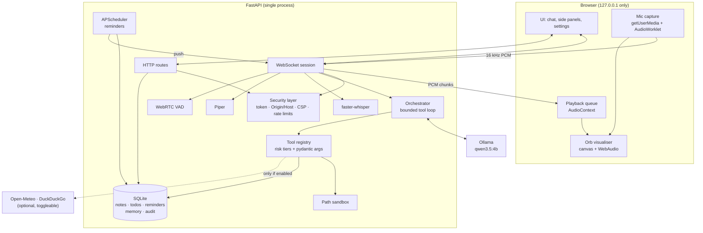
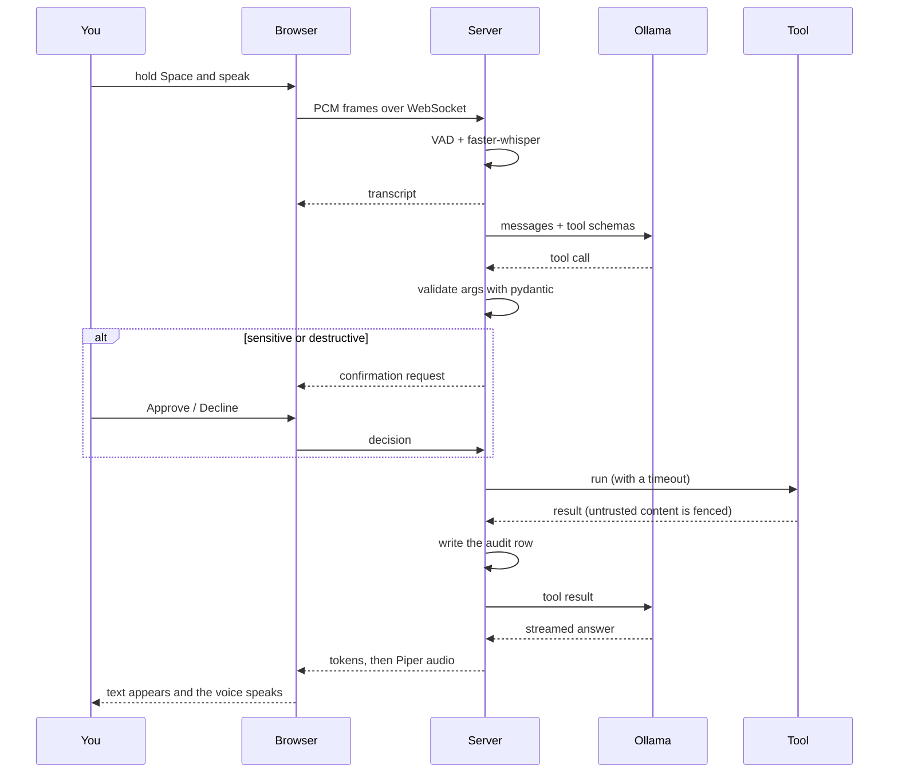

# Nova

A complete voice **and** text personal assistant that runs entirely on your own
machine. Speech recognition, the language model, speech synthesis and all your
data stay local — nothing is sent anywhere unless you explicitly ask for the
weather or a web search, and both of those can be switched off.

Built on [Ollama](https://ollama.com) (`qwen3.5:4b` by default),
[faster-whisper](https://github.com/SYSTRAN/faster-whisper),
[Piper](https://github.com/OHF-Voice/piper1-gpl) and FastAPI.

> The project name is configurable. Set `NOVA_APP_NAME` to call it whatever you like.

---

## What it does

- **Talk or type.** Hold <kbd>Space</kbd> to speak, or just type. It transcribes
  what you said, answers, and speaks the answer back. Speaking again or pressing
  <kbd>Esc</kbd> interrupts it mid-sentence (barge-in).
- **Gets things done** through a small, reliable set of tools: notes, todos,
  reminders in plain language ("remind me in 20 minutes to stretch"), sandboxed
  file search and reading, launching whitelisted apps, system readings, weather,
  web search, and a safe calculator.
- **Remembers what you tell it to.** Durable facts are stored only when you ask,
  and you can view or delete every one of them from the settings drawer.
- **Asks before doing anything consequential.** Deleting, launching an app or
  leaving your machine always needs a click. The model cannot approve itself.
- **Shows you everything it did.** Every tool call is written to an audit log you
  can read in the Activity tab.

---

## Screenshots

<!-- Replace these with real captures: the orb mid-reply, and the confirmation modal. -->

| Conversation | Confirmation |
| --- | --- |
| _`docs/screenshot-chat.png` — placeholder_ | _`docs/screenshot-confirm.png` — placeholder_ |

---

## Architecture



One turn, end to end:



---

## Setup

### Requirements

- Python 3.11, 3.12 or 3.13
- [Ollama](https://ollama.com) installed and running
- About 4 GB of disk for the model, plus ~200 MB for the voice and whisper models

### 1. Install Ollama and pull the model

```bash
ollama serve           # in its own terminal, if it is not already running
ollama pull qwen3.5:4b
```

### 2. Install Nova

```bash
git clone https://github.com/Fahad28may/nova.git
cd nova

# with uv (recommended)
uv venv --python 3.12
uv pip install -e .

# or with plain pip
python -m venv .venv
.venv/bin/pip install -e .          # Windows: .venv\Scripts\pip install -e .
```

### 3. Download a voice

```bash
python scripts/download_voice.py              # en_US-amy-medium, ~60 MB
python scripts/download_voice.py --list       # see the other voices
```

The faster-whisper model downloads itself the first time you use the microphone.

### 4. Configure (optional)

```bash
cp .env.example .env
```

The defaults work out of the box. The two settings worth looking at are
`NOVA_ALLOWED_ROOTS` (which folders Nova may read) and `NOVA_ALLOWED_APPS`
(which applications it may launch).

### 5. Run it

```bash
python -m nova
```

or use the one-command script, which sets up the environment, checks Ollama and
downloads a voice if needed:

```bash
./scripts/run.sh            # macOS / Linux
.\scripts\run.ps1           # Windows
```

Nova prints a link with a session token in it:

```
  Open this link (it carries your session token):

      http://127.0.0.1:8765/?token=aB3dEf...
```

Open it (the browser opens automatically unless you pass `--no-browser`). Grant
microphone access when asked, and you are ready.

---

## Using it

| Action | How |
| --- | --- |
| Send a message | <kbd>Enter</kbd> |
| New line | <kbd>Shift</kbd> + <kbd>Enter</kbd> |
| Push to talk | Hold <kbd>Space</kbd>, or hold the mic button |
| Toggle the mic | <kbd>Ctrl</kbd> + <kbd>K</kbd> |
| Stop everything | <kbd>Esc</kbd> |
| Hands-free mode | Settings → it listens until you stop speaking |
| Light / dark | The sun/moon button |

Things to try:

- "Remind me in 20 minutes to take the bread out."
- "Add milk and oats to my todo list."
- "Take a note: the spare key is in the blue tin."
- "What is 19 times 37 divided by 4?"
- "What's the weather in Karachi tomorrow?"
- "Remember that I prefer metric units."
- "Find any markdown file about budgets and read it to me."

---

## Configuration

Everything is set through environment variables (or a `.env` file), all prefixed
`NOVA_`. See [`.env.example`](.env.example) for the complete annotated list.

### Core

| Variable | Default | What it does |
| --- | --- | --- |
| `NOVA_APP_NAME` | `Nova` | The name shown in the UI and spoken prompts |
| `NOVA_HOST` | `127.0.0.1` | Bind address. **Loopback only** — anything else is refused |
| `NOVA_PORT` | `8765` | Port to listen on |
| `NOVA_AUTH_TOKEN` | random each start | Session token. Set it only if you want a stable bookmark |
| `NOVA_OPEN_BROWSER` | `true` | Open a browser on startup |
| `NOVA_DB_PATH` | `data/nova.db` | SQLite file |
| `NOVA_LOG_LEVEL` | `INFO` | `DEBUG`, `INFO`, `WARNING`, `ERROR` |
| `NOVA_LOG_JSON` | `false` | JSON log lines instead of key=value |

### Model

| Variable | Default | What it does |
| --- | --- | --- |
| `NOVA_OLLAMA_MODEL` | `qwen3.5:4b` | Any model Ollama has that supports tools |
| `NOVA_OLLAMA_HOST` | `http://127.0.0.1:11434` | Where Ollama is listening |
| `NOVA_OLLAMA_THINK` | `false` | Extended thinking. Off for speed; on for hard questions |
| `NOVA_TEMPERATURE` | `0.2` | Low, so tool calls stay reliable |
| `NOVA_NUM_CTX` | `8192` | Context window passed to Ollama |
| `NOVA_CONTEXT_TOKEN_BUDGET` | `3500` | How much history is kept per turn |
| `NOVA_MAX_TOOL_ITERATIONS` | `4` | Hard cap on the tool loop |
| `NOVA_TOOL_TIMEOUT_S` | `20` | Per-tool timeout |
| `NOVA_HISTORY_TURNS` | `12` | Conversation turns considered for context |

### Voice

| Variable | Default | What it does |
| --- | --- | --- |
| `NOVA_STT_ENABLED` | `true` | Microphone input |
| `NOVA_WHISPER_MODEL` | `base` | `tiny`, `base`, `small`, `medium`, `large-v3` |
| `NOVA_WHISPER_COMPUTE_TYPE` | `int8` | `int8` is the CPU-friendly choice |
| `NOVA_WHISPER_LANGUAGE` | `en` | Empty for automatic detection |
| `NOVA_TTS_ENABLED` | `true` | Spoken replies |
| `NOVA_PIPER_VOICE_PATH` | `models/piper/en_US-amy-medium.onnx` | Which voice to use |
| `NOVA_PIPER_LENGTH_SCALE` | `1.0` | Speaking speed (lower is faster) |
| `NOVA_VAD_ENABLED` | `true` | Silence detection for hands-free mode |
| `NOVA_VAD_SILENCE_MS` | `900` | Silence before a hands-free turn ends |
| `NOVA_WAKEWORD_ENABLED` | `false` | Needs `uv pip install -e ".[wakeword]"` |

### Tools and access

| Variable | Default | What it does |
| --- | --- | --- |
| `NOVA_ALLOWED_ROOTS` | `~/Documents`, `~/Downloads` | Folders Nova may read. The first is the "default" root |
| `NOVA_ALLOWED_APPS` | a few per platform | Apps it may launch, as `id → {label, argv}` |
| `NOVA_WEATHER_ENABLED` | `true` | Open-Meteo lookups (no API key) |
| `NOVA_WEB_SEARCH_ENABLED` | `true` | DuckDuckGo search |
| `NOVA_WEATHER_LATITUDE` / `_LONGITUDE` | unset | Your default location |

Both lists are JSON:

```bash
NOVA_ALLOWED_ROOTS=["C:/Users/me/Documents","D:/notes"]
NOVA_ALLOWED_APPS={"notepad":{"label":"Notepad","argv":["notepad.exe"]},"vscode":{"label":"VS Code","argv":["code"]}}
```

Nova can launch **nothing** that is not in that list, and read **nothing**
outside those roots.

### Limits

| Variable | Default |
| --- | --- |
| `NOVA_MAX_MESSAGE_CHARS` | `4000` |
| `NOVA_MAX_AUDIO_SECONDS` | `60` |
| `NOVA_MAX_FILE_BYTES` | `524288` |
| `NOVA_HTTP_RATE_LIMIT` / `_WINDOW_S` | `180` per `60s` |
| `NOVA_WS_RATE_LIMIT` / `_WINDOW_S` | `60` per `60s` |

---

## Security model

Nova holds the keys to your files, your apps and a microphone, so it is built to
be cautious by default.

### Nothing but this machine

- Binds to `127.0.0.1` only. A non-loopback `NOVA_HOST` is rejected at startup.
- A random session token (`secrets.token_urlsafe`) is generated at every start and
  required on every HTTP request and WebSocket frame, compared in constant time.
  It is stored in an `HttpOnly`, `SameSite=Strict` cookie.
- `Origin` and `Host` are validated on every request and on the WebSocket
  handshake, which stops DNS rebinding and cross-site WebSocket hijacking. There
  is no CORS middleware at all.
- A strict CSP: `default-src 'none'`, no inline scripts, no `eval`, no CDNs.
  Every asset is self-hosted. Plus `nosniff`, `frame-ancestors 'none'`,
  `no-referrer` and a `Permissions-Policy` that allows the microphone only for
  this origin.

### Risk tiers

Every tool declares what it can do, and the UI gates the rest:

| Tier | Examples | Behaviour |
| --- | --- | --- |
| **safe** | calculator, system info, list notes, read a file in the default folder | Runs immediately |
| **sensitive** | `open_app`, `web_search`, `files_search`, reading outside the default folder | **You confirm** |
| **destructive** | delete a note or todo, cancel a reminder, forget memory | **You confirm** |

The confirmation request goes to the browser and the turn waits for a real click.
The model has no way to answer on your behalf, an unanswered prompt times out as
a refusal, and declining is reported back so it stops instead of retrying.

### Filesystem sandbox

- Read-only, confined to `NOVA_ALLOWED_ROOTS`.
- Paths are fully resolved with `Path.resolve()`, so `..` traversal **and
  symlinks pointing outside** are both rejected.
- Hidden files and sensitive names are blocked regardless: `.env`, `.ssh`,
  `id_rsa`, `*.pem`, `*.key`, browser profiles, credential stores and so on.
- Only known text extensions are readable, with a byte cap and truncation.

### Prompt-injection defence

File contents and web results are wrapped in `<untrusted_data>` fences with an
explicit instruction never to obey them, and content from them cannot close its
own fence. Once untrusted content has entered a turn, any later confirmation
prompt is flagged in the UI as *"requested after reading external content"*.
Because sensitive and destructive tools always need a click, injected text can
never reach a dangerous tool on its own.

### Process and data safety

- No `shell=True` anywhere. Subprocesses use fixed argument vectors; app launches
  come from the whitelist, and notification text is passed through the
  environment rather than a command line.
- Parameterised SQL only.
- Model output is rendered into the DOM as text nodes by a small sanitising
  Markdown renderer. `innerHTML` is never used — the CSP would block it anyway.
- Arithmetic is evaluated by walking an AST allow-list. `eval` is never used.
- Rate limits on HTTP, WebSocket messages and audio frames; caps on message
  length, recording length and file size.
- Audio is processed in memory and never written to disk.
- No telemetry. The only outbound calls are weather and web search, both
  toggleable.
- Secrets are redacted from logs and from the audit log. `.env` is never
  committed.
- Unhandled errors are logged locally and answered with a generic message — no
  stack trace ever reaches the browser.

### Verifying it yourself

```bash
pytest                      # 261 tests, including the security cases
bandit -c pyproject.toml -r src
pip-audit
mypy
```

---

## Development

```bash
uv pip install -e ".[dev]"
pre-commit install

pytest                      # tests
ruff check src tests        # lint
ruff format src tests       # format
mypy                        # strict type checking
bandit -c pyproject.toml -r src
pip-audit
```

### Layout

```
src/nova/
  api/        HTTP routes, WebSocket session, dependencies
  core/       events, scheduler, time parsing, notifications
  db/         SQLite schema and typed queries
  llm/        Ollama client, prompts, context trimming, tool loop
  security/   auth, headers, rate limiting, path sandbox
  tools/      one module per tool family
  voice/      faster-whisper, Piper, VAD, wake word
  static/     the UI (no build step)
tests/        pytest suite
scripts/      voice download, run scripts
```

### Adding a tool

Subclass `Tool`, give it a pydantic argument model and a risk tier, and register
it in `build_registry()`:

```python
class SetTimerArgs(BaseModel):
    model_config = {"extra": "forbid"}
    minutes: int = Field(ge=1, le=240, description="How long to wait.")


class SetTimer(Tool):
    name: ClassVar[str] = "set_timer"
    description: ClassVar[str] = "Start a countdown timer."
    args_model: ClassVar[type[BaseModel]] = SetTimerArgs
    risk: ClassVar[RiskTier] = RiskTier.SAFE

    async def run(self, args: SetTimerArgs, context: ToolContext) -> ToolResult:
        ...
```

Keep the description under about 100 characters — a 4B model picks tools far more
reliably from short, unambiguous descriptions.

---

## Troubleshooting

**"Ollama is not reachable"** — start it with `ollama serve`, then reload the
page. Check `NOVA_OLLAMA_HOST` if you changed the port.

**"The model 'qwen3.5:4b' is not installed"** — run `ollama pull qwen3.5:4b`, or
point `NOVA_OLLAMA_MODEL` at a model you already have. It must support tool
calling.

**"Session token required"** — open the link Nova printed at startup. Each run
generates a new token unless you set `NOVA_AUTH_TOKEN`.

**The mic button is disabled** — either `NOVA_STT_ENABLED=false`, or the browser
does not expose `AudioWorklet`. Chrome, Edge, Firefox and Safari all do on
`http://127.0.0.1`.

**Microphone permission is refused** — browsers only allow microphone access on
secure origins; `127.0.0.1` counts as one, but `localhost` aliases on some
networks do not. Use the printed `127.0.0.1` link.

**No voice, or "the voice model is missing"** — run
`python scripts/download_voice.py`, and check `NOVA_PIPER_VOICE_PATH`.

**Replies are slow** — a 4B model on CPU takes a few seconds. Keep
`NOVA_OLLAMA_THINK=false`, use `NOVA_WHISPER_MODEL=tiny`, and lower
`NOVA_CONTEXT_TOKEN_BUDGET`. The first reply after startup is always the slowest
while the model loads.

**It picks the wrong tool** — lower `NOVA_TEMPERATURE`, or disable the tools you
do not need (`NOVA_WEB_SEARCH_ENABLED=false`). Fewer tools means better choices.

**"I did not catch that"** — the clip was under a quarter of a second, or VAD
heard only silence. Hold the key a moment longer, or lower
`NOVA_VAD_AGGRESSIVENESS`.

**Reminders do not pop up** — the in-page toast always works; the OS
notification is best-effort and needs `notify-send` on Linux.

**A file cannot be read** — it is outside `NOVA_ALLOWED_ROOTS`, hidden, a blocked
name, a non-text extension, or over `NOVA_MAX_FILE_BYTES`. The Activity tab
records the exact reason.

---

## License

MIT — see [LICENSE](LICENSE).

Security issues: please read [SECURITY.md](SECURITY.md).
Contributions: [CONTRIBUTING.md](CONTRIBUTING.md).
